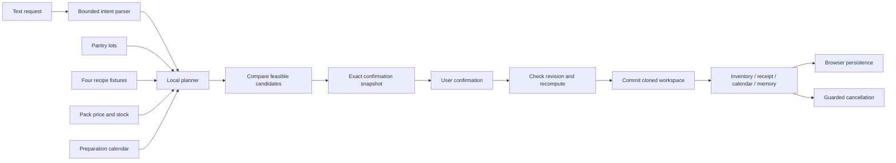

# TableReady architecture

## Entry route

TableReady is a web-based **Alexa+ simulated experience** using custom local agentic tools. Its entry point is `app.js`; domain orchestration lives in `agent.js`. Local adapters model pantry, grocery and calendar services. The implementation follows the [simulation alternative in the official rules](https://amazonappdev2026.devpost.com/rules).

## Planning tools

`parseRequest` extracts supported fields or returns a clarification. Follow-up changes retain the pending request's other constraints.

`listPantry` excludes lots whose label date precedes the meal date. `compareRecipes` scales each recipe, allocates eligible lots in label-date order, rounds shortages to purchasable packs, and checks stock, budget, declared exclusions, diet, preparation lead time and calendar overlap. It exposes actual tool inputs and outputs for the interface trace.

The pantry coverage percentage averages the fraction supplied for each required ingredient. It is an ingredient-coverage score, not a percentage of meal weight or cost. Near-date use counts pantry allocation records with label dates within three days of the meal.

Eligible candidates are ranked by:

`nearDateUses * 20 + pantryCoverage * 0.5 - shoppingDollars * 0.8 - preparationMinutes * 0.15 + explicitRecipePreference * 100`

The formula is an authored product policy. An explicit recipe that fails a hard check returns a request for change rather than selecting a different meal automatically.

## Consent contract

`buildPlan` records the request, recipe, pantry quantities, pack basket, total, preparation interval and workspace revision. Its snapshot is their JSON representation.

`verifyPlan` compares the submitted fields with the stored snapshot, checks the revision, and rebuilds the plan using the current clock and workspace. `commitPlan` proceeds on a cloned workspace only after those checks pass. The plan ID acts as an idempotency key: a repeated confirmation returns its existing receipt without another allocation or order.

Confirmation reduces allocated pantry quantities and catalogue pack stock, records unused pack quantities as pantry lots, and creates the simulated receipt and calendar appointment. It also saves the confirmed preference profile and ledger. A future supplier adapter will separate reservation, delivery and consumption and derive product dates from supplier data.

## Cancellation

A receipt retains the previous pantry and catalogue. Cancellation is available before preparation starts and only while the confirmation remains the latest workspace revision. It restores the saved quantities, marks the order and appointment cancelled, and records the reversal. Confirmed preference memory is retained.

This conservative rule avoids replacing newer workspace changes with an older snapshot. Connected services would need per-operation compensating actions and supplier responses rather than whole-workspace restoration.

## Storage and interfaces

The `tableready-workspace-v1` localStorage record contains inventory, orders, calendar, preferences and ledger. The interface escapes user strings and reports storage failures. A page reload reloads committed state; an unconfirmed conversation is session state.

The text-planning path has no remote service dependency. The user submits a request and separately confirms the resulting actions.

The domain model is designed for a single browser workspace. Connected operation would add authentication, service-specific quote versions, durable storage and server-side transaction validation.
